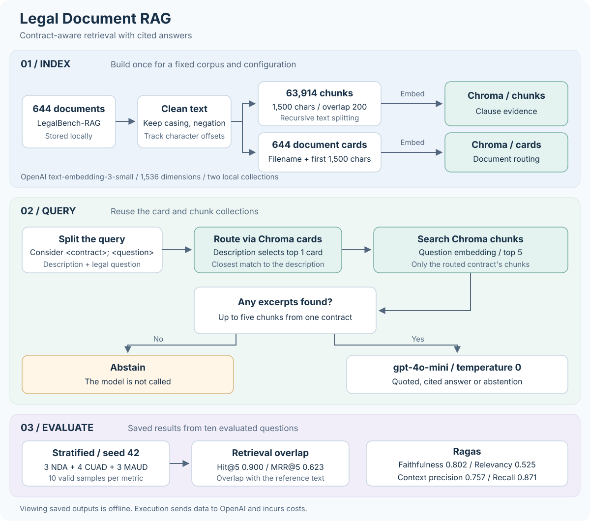

# Legal Document RAG

**Question answering over legal contracts, with contract-aware retrieval and cited answers.**

By **Rishabh Jain**

This project answers questions about 644 contracts from the [LegalBench-RAG](https://github.com/zeroentropy-ai/legalbenchrag) benchmark. Each question names a contract. The pipeline finds that contract, retrieves its most relevant clauses and asks an LLM to answer with quoted evidence, or to abstain when the excerpts do not support an answer.



**Explore:** [Visual report](https://rishabhjain9196.github.io/legal-document-rag/) · [Notebook](notebooks/legal_document_rag.ipynb) · [Walkthrough](docs/walkthrough.md) · [Dataset setup](data/README.md) · [Evaluation chart](docs/assets/evaluation.png)

## Results

Ten benchmark questions were evaluated: three NDA, four CUAD and three MAUD questions, selected with seed 42. Every metric has a score for all ten questions.

| Measure | Score | What it measures |
| --- | ---: | --- |
| Hit@5 | 0.900 | Share of questions where a retrieved chunk overlaps the reference text |
| MRR@5 | 0.623 | How early the first overlapping chunk appears in the results |
| Ragas faithfulness | 0.802 | Support for the answer's claims in the retrieved excerpts |
| Ragas answer relevancy | 0.525 | How directly the answer addresses the question |
| Ragas context precision | 0.757 | Ranking of useful excerpts above less useful ones |
| Ragas context recall | 0.871 | Coverage of the reference answer by the retrieved excerpts |

- Retrieval found reference text for nine of the ten questions. The model abstained on two, so at least one retrieved clause did not lead to an answer.
- Context recall (0.871) is well above answer relevancy (0.525). The next gains are in how the model uses the retrieved evidence.
- In one example, the model identified a six-month notice period for terminating a contract renewal and quoted the clause.

The [walkthrough](docs/walkthrough.md) shows the exploration and evaluation charts. The scores are also available in [metrics.json](docs/assets/metrics.json).

## How it works

1. **Prepare:** Clean the text while keeping casing, negation and character offsets, so every chunk maps back to its source.
2. **Index:** Split the documents into 63,914 chunks of 1,500 characters with a 200-character overlap. Create one document card per contract from its file name and first 1,500 characters.
3. **Embed:** Store chunks and cards in two local Chroma collections, using OpenAI `text-embedding-3-small`.
4. **Route:** Split each question, `Consider <contract>; <question>`, at the semicolon. Match the contract description to the closest document card.
5. **Retrieve:** Search only that contract's chunks with the legal question and keep the top five.
6. **Answer:** `gpt-4o-mini` at temperature 0 answers with quoted clauses and source citations. If no excerpts are found, the chain abstains without calling the model.

Routing selects a single contract. If it selects the wrong one, the answer draws on evidence from that contract. The answers are model-generated and are not legal advice.

## Quick start

Requirements: Python 3.12 and an OpenAI API key.

```bash
python3.12 -m venv .venv
source .venv/bin/activate      # Windows: .venv\Scripts\activate
pip install -r requirements.txt
cp .env.example .env           # Windows: copy .env.example .env
```

1. Add your OpenAI API key to `.env`.
2. Download the dataset and arrange it as described in [data/README.md](data/README.md).
3. Open the [notebook](notebooks/legal_document_rag.ipynb) in Jupyter or another notebook editor, select the `.venv` kernel and run the cells in order. The notebook works from the repository root or the `notebooks` folder.

The saved outputs, charts and documentation can be read without running anything. To export the charts again from the saved notebook outputs, run `python scripts/export_assets.py` from the repository root. It makes no API calls.

## Cost and reproducibility

- Running the notebook sends document text, questions and retrieved excerpts to OpenAI. Embedding the corpus processes about 13.5 million tokens, and the evaluation adds generation and Ragas calls.
- The Chroma index in `chroma_legal_db` is reused between runs. Delete it, or use a new folder, after changing the text, chunking or embedding model.
- Seed 42 fixes the question sample. Model answers and Ragas scores can still vary between runs.

## Repository structure

```text
notebooks/legal_document_rag.ipynb   End-to-end pipeline with saved results
docs/walkthrough.md                  Process diagrams, charts and findings
docs/index.html                      Visual report, published with GitHub Pages
docs/assets/                         Pipeline diagram, charts and metrics.json
scripts/export_assets.py             Exports charts and scores from the saved notebook
data/README.md                       Dataset download and folder layout
requirements.txt                     Pinned dependencies
.env.example                         API key template
```

## Acknowledgements

The documents and questions come from [LegalBench-RAG](https://github.com/zeroentropy-ai/legalbenchrag) (Pipitone and Houir Alami, 2024, [arXiv:2408.10343](https://arxiv.org/abs/2408.10343)), which builds on ContractNLI, CUAD, MAUD and PrivacyQA.
