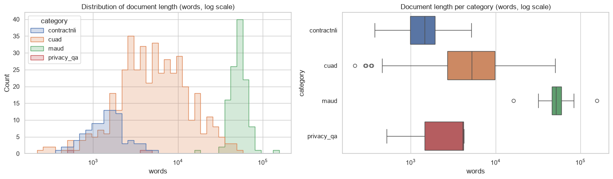
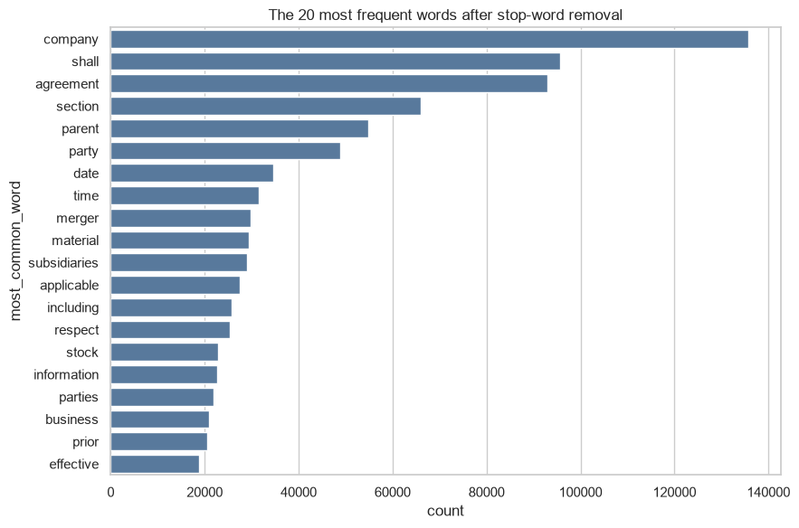
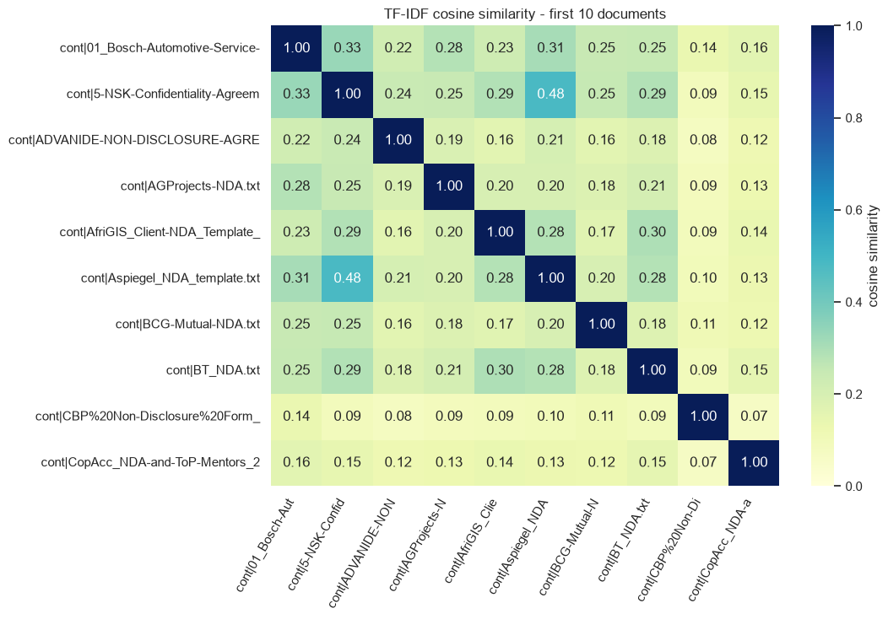
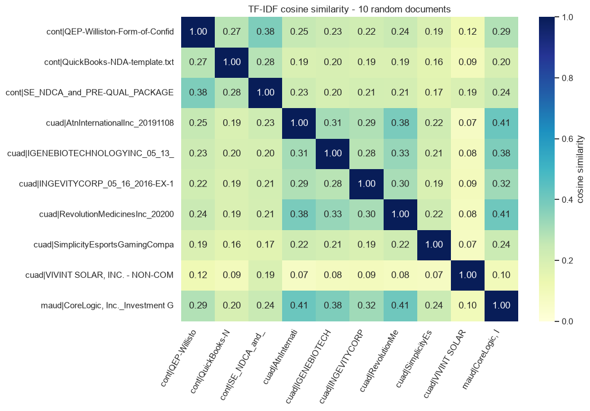
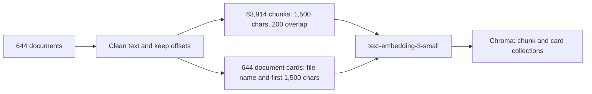
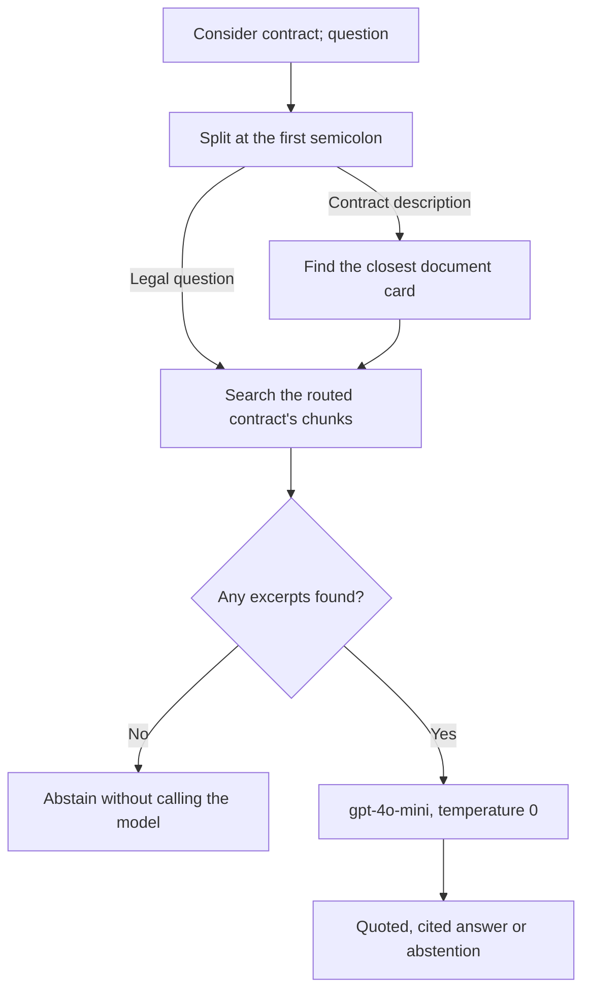
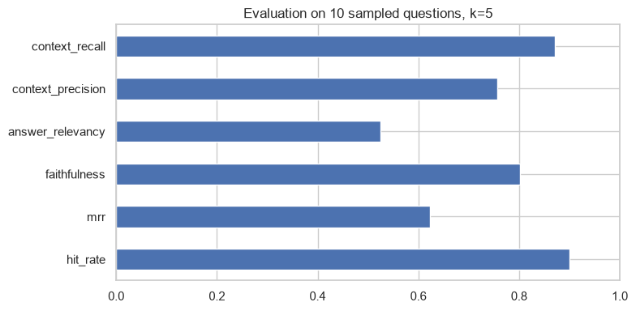

# How the pipeline works

[Back to the README](../README.md) · [Open the notebook](../notebooks/legal_document_rag.ipynb)

The pipeline first identifies the contract that a question refers to, then searches only that contract's clauses. This keeps evidence from similar contracts out of the answer.

## 1. Data

The corpus contains 644 documents from [LegalBench-RAG](https://github.com/zeroentropy-ai/legalbenchrag), in four groups:

| Group | Documents | Mean words per document |
| --- | ---: | ---: |
| ContractNLI NDAs | 93 | 1,612 |
| CUAD commercial contracts | 431 | 7,853 |
| MAUD merger agreements | 117 | 53,646 |
| PrivacyQA privacy policies | 3 | 2,953 |
| **Total** | **644** | **15,248** |

- The benchmarks contain 6,695 questions. Source documents are available for 6,033 of them.
- Each benchmark answer is a supporting text span, given as a file path and character range.
- Every question follows the pattern `Consider <contract>; <question>`. The legal questions are generic, such as asking for the governing law, so the contract description is what identifies the right document.

## 2. Cleaning

- Retrieval text keeps its casing and negation, because words such as "not" and "shall" change the meaning of a clause.
- Email addresses, URLs, phone numbers and separator lines are replaced with spaces, and whitespace is normalised.
- An offset map links every cleaned character to its position in the source file. Chunks and citations use these offsets.
- Lower-case tokens without stop words are used only for the exploratory analysis.

## 3. Exploration

### Document lengths

- The median document has 5,494 words and the mean is 15,248. The long MAUD agreements raise the mean.
- Lengths range from 219 to 156,104 words, so documents are split into chunks before retrieval.

### Word frequencies

- The most frequent words, such as "company", "shall" and "agreement", are common legal terms.
- The least frequent words are mostly names and text artefacts.

### TF-IDF similarity

- The first ten documents, all NDAs, have a mean pairwise similarity of 0.19.
- Ten random documents have a mean pairwise similarity of 0.23.
- Contracts share legal vocabulary but differ in wording.

## 4. Indexing

- `RecursiveCharacterTextSplitter` splits at paragraph, line, sentence and clause boundaries before splitting words.
- Chunks of 1,500 characters with a 200-character overlap produce 63,914 chunks. The overlap helps keep text near a boundary within one chunk.
- Each contract also gets a document card containing its file name and first 1,500 characters, where titles and party names usually appear.
- Chunks and cards are embedded with `text-embedding-3-small` and stored in two Chroma collections in `chroma_legal_db`.

## 5. Routing and answering

- The contract description is matched to the closest document card, which selects one contract.
- The legal question is searched against that contract's chunks only. The top five chunks form the context.
- If no excerpts are found, the chain abstains without calling the model.
- Otherwise `gpt-4o-mini` answers at temperature 0. The prompt sets these rules:
  - The model gives a direct answer only when a clause supports it.
  - Every conclusion includes an exact quote and a `[Source n]` citation.
  - The model does not infer a permission from a missing prohibition, or the reverse.
  - The model abstains when the excerpts do not support an answer.

## 6. Evaluation

Ten questions were evaluated: three NDA, four CUAD and three MAUD questions, selected with seed 42.

| Retrieval | Score | Ragas | Score |
| --- | ---: | --- | ---: |
| Hit@5 | 0.900 | Faithfulness | 0.802 |
| MRR@5 | 0.623 | Answer relevancy | 0.525 |
| | | Context precision | 0.757 |
| | | Context recall | 0.871 |

- Hit@5 counts a question as a hit when any of the top five chunks overlaps the reference span. MRR@5 rewards an earlier first hit.
- Ragas uses an LLM to score faithfulness, answer relevancy, context precision and context recall.

### What the run shows

- Retrieval is the stronger step. Nine of ten questions had a hit, and context recall is 0.871.
- Answering is the weaker step. The model abstained twice, so at least one retrieved clause did not lead to an answer. Answer relevancy is 0.525.
- Ranking matters. An MRR@5 of 0.623 shows that the best chunk is often not the first result.
- In one example, the model found a six-month notice period for ending a contract renewal and quoted the clause.

### Next steps

- Review routing errors and test richer document cards.
- Re-rank the retrieved chunks so that the most relevant clause comes first.
- Compare clause-aware chunking with fixed character windows.
- Adjust the prompt so that partially matching clauses lead to an answer rather than an abstention.

## Reproducing the results

See the [quick start](../README.md#quick-start). Reading the saved outputs and running `python scripts/export_assets.py` make no API calls. Running the notebook calls the OpenAI API.
